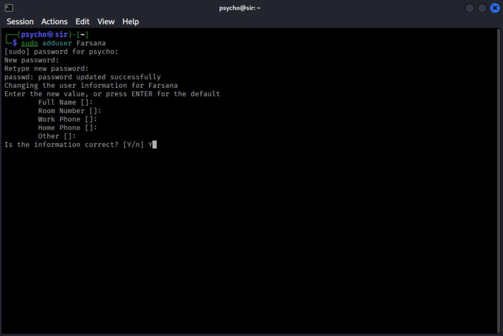

<div align="center">

# 🕵️ theHarvester — OSINT Reconnaissance Lab

### Passive Footprinting • Public Data Sources • Linux Security Lab


**A practical walkthrough by [PsychoMods](https://github.com/Psychomods666)**

*Learn the workflow. Understand the output. Verify responsibly.*

</div>

---

## 🧭 Overview

This repository documents a hands-on **OSINT (Open-Source Intelligence) reconnaissance** exercise using [theHarvester](https://github.com/laramies/theHarvester). The practical covers Linux user administration, privilege management, obtaining the tool, selecting public data sources, and interpreting the resulting reconnaissance output.

theHarvester helps security practitioners collect publicly available information associated with a domain, such as hostnames, email addresses, IP addresses, and names, depending on the configured data sources and their current availability.

> ⚠️ **Scope note:** This README documents a learning workflow. It does not claim that the target was vulnerable, compromised, or accessed without authorization. Only investigate domains you own or have explicit permission to assess.

## 📚 Contents

- [Objectives](#-objectives)
- [Lab environment](#️-lab-environment)
- [Practical walkthrough](#-practical-walkthrough)
- [Understanding the output](#-understanding-the-output)
- [Workflow](#-reconnaissance-workflow)
- [Key learning](#-key-learning)
- [Responsible use](#️-responsible-use)
- [Project structure](#-project-structure)
- [References](#-references)
- [Author](#-author)

## 🎯 Objectives

- Create a separate Linux user for lab work.
- Learn how `sudo` group membership grants administrative privileges on Debian/Kali-style systems.
- Understand the difference between a regular user, `sudo`, and a root shell.
- Clone the upstream theHarvester repository.
- Run a domain-focused OSINT collection using selected sources.
- Interpret host, IP, email, and people result categories.
- Document evidence while protecting target-specific information.

## 🛠️ Lab environment

| Component | Purpose |
|---|---|
| Linux / Kali-style terminal | Command-line lab environment |
| `adduser` / `usermod` | User and group administration |
| `sudo` / `su` | Privilege management and user switching |
| Git | Clone the upstream repository |
| theHarvester | Public-source OSINT collection |
| Hackertarget, crt.sh, CertSpotter | Selected public data sources in the recorded command |

The screenshots show a terminal-based Linux session. Exact package versions, available data sources, and output may vary by distribution and the current upstream release.

---

# 🧪 Practical Walkthrough

## 01 — Create a New Linux User

### Command

```bash
sudo adduser Farsana
```

### What it does

Creates a separate local user account named `Farsana`. The command prompts for a password and optional profile information such as full name and contact fields.

- Enter a strong password when prompted.
- Press **Enter** to skip optional profile fields.
- Confirm the information when asked.

### 📸 Terminal evidence



> **Privacy tip:** Do not publish screenshots containing real passwords, personal contact information, or other account details.

## 02 — Add the User to the `sudo` Group

### Command

```bash
sudo usermod -aG sudo Farsana
```

### Explanation

- `usermod` modifies an existing user account.
- `-a` appends the user to the group instead of replacing their supplementary group memberships.
- `-G sudo` adds the account to the `sudo` group.

On Kali/Debian-style systems, membership in the configured `sudo` group commonly grants permission to run commands with elevated privileges. The exact policy depends on the system's sudo configuration.

### Verify group membership

```bash
groups Farsana
```

Look for `sudo` in the output.

## 03 — Switch to the New User

### Command

```bash
su - Farsana
```

### Explanation

The `su -` command switches to the specified user and starts a login shell, loading that user's environment. Enter the new user's password when prompted.

The shell prompt should now show the new username.

### Verify the current account

```bash
whoami
```

Expected output:

```text
Farsana
```

## 04 — Request Administrative Privileges

### Command

```bash
sudo -i
```

### Explanation

This requests an interactive root login shell through `sudo`. Enter the password for the account that is authorized to use `sudo`, if prompted.

Verify the effective user:

```bash
whoami
```

Expected output:

```text
root
```

**Important distinction:** adding a user to the `sudo` group does not automatically make every command run as root. Use elevated privileges only when needed, and return to the regular user shell with `exit` when finished.

## 05 — Clone theHarvester

### Upstream repository

[github.com/laramies/theHarvester](https://github.com/laramies/theHarvester)

### Command

```bash
git clone https://github.com/laramies/theHarvester.git
cd theHarvester
```

### Explanation

- `git clone` downloads a local copy of the upstream source repository.
- `cd theHarvester` enters the downloaded project directory.

If the directory already exists, do not clone over it. Inspect the existing checkout and follow the upstream project's current update instructions.

### 📸 Terminal evidence


## 06 — Run a Domain-Focused OSINT Collection

The recorded command used the following format:

```bash
theHarvester -d example.com -b hackertarget,crtsh,certspotter
```

Replace `example.com` with a domain you own or are explicitly authorized to assess. The domain shown in the original terminal evidence has been redacted in the public screenshot.

### Option breakdown

| Option | Meaning |
|---|---|
| `-d` | Specifies the domain to investigate |
| `-b` | Selects the data sources to query |
| `hackertarget` | Queries the supported HackerTarget source |
| `crtsh` | Uses certificate-transparency search via crt.sh |
| `certspotter` | Uses the Cert Spotter source when supported by the installed release |

Check the version's help output and current upstream documentation for supported source names and syntax. Source availability can change, and some providers may require API keys or impose usage limits.

> **Operational note:** Although these are public-source lookups, they can still be subject to provider terms, rate limits, and organizational policies.

## 07 — Review the Results

The recorded terminal output reported:

- **13 hosts found**
- **No IPs found** in the tool's separate IP result category
- **No emails found**
- **No people found**

The tool also displayed hostnames and associated IP addresses in the terminal. Those identifiers are redacted in the screenshot included here to avoid unnecessarily publishing target-specific reconnaissance data.

### 📸 Terminal evidence


**How to interpret this:** the “hosts found” count indicates hostnames returned by the configured sources in that run. A separate “no IPs found” message does not necessarily mean the hostnames have no IP addresses; it means the tool did not return results in that particular result category. Output depends on the source, query, version, and time of collection.

---

## 📊 Understanding the Output

| Result category | What it generally represents |
|---|---|
| Hosts | Hostnames associated with the domain that were discovered through selected sources |
| IP addresses | IP addresses returned in the relevant result category |
| Emails | Publicly indexed email addresses associated with the query |
| People | Names or people-related results returned by supported sources |
| Data sources | Providers queried during the collection |

### Important limitations

- A result may be stale, duplicated, incomplete, or incorrectly attributed.
- No result does not prove that the information does not exist.
- A discovered hostname is not proof of a vulnerability.
- Publicly visible data can still be sensitive; avoid unnecessary collection and disclosure.
- Validate important findings with authorized methods before drawing conclusions.

## 🔬 Reconnaissance Workflow

```text
Linux Lab Setup
      │
      ▼
Create Dedicated User
      │
      ▼
Configure sudo Access
      │
      ▼
Clone theHarvester
      │
      ▼
Select Public Data Sources
      │
      ▼
Collect Domain-Related Results
      │
      ▼
Review & Validate Findings
      │
      ▼
Document Responsibly
```

## 🧠 Key Learning

Through this practical, I learned how to:

- Create and manage a Linux user account.
- Add a user to the `sudo` group and verify group membership.
- Switch between user and root shells.
- Clone a security tool from GitHub.
- Use theHarvester's domain and source options.
- Understand the difference between host, IP, email, and people result categories.
- Document a reconnaissance workflow while redacting target-specific information.

## 🛡️ Responsible Use

This repository is for **cybersecurity education and authorized OSINT practice**.

- Investigate only domains you own or have explicit authorization to assess.
- Respect source-provider terms, rate limits, applicable laws, and organizational policies.
- Do not use collected information to harass, dox, impersonate, or target individuals.
- Redact personal information, internal hostnames, IP addresses, tokens, and other sensitive details before publishing evidence.
- Treat results as leads for verification, not confirmed security findings.
- Use root privileges only when required; prefer least privilege.

## 📁 Project Structure

```text
theharvester-osint-lab/
├── README.md
├── 01-linux-user-and-root-setup.jpg
├── 02-theharvester-install-and-command.jpg
└── 03-theharvester-results-redacted.jpg
```

## 🔗 References

- [theHarvester — upstream GitHub repository](https://github.com/laramies/theHarvester)
- [theHarvester documentation](https://github.com/laramies/theHarvester/wiki)
- [HackerTarget](https://hackertarget.com/)
- [crt.sh — Certificate Transparency Search](https://crt.sh/)
- [Cert Spotter](https://sslmate.com/certspotter/)
- [PsychoMods — GitHub profile](https://github.com/Psychomods666)

---

## 👨‍💻 Author

<div align="center">

### PsychoMods

**Cybersecurity • OSINT • Ethical Hacking • Security Education**

[GitHub](https://github.com/Psychomods666)

*Learn • Test • Verify • Secure*

</div>

---

<div align="center">

*Personal educational lab notes. Not an official theHarvester project.*

</div>
